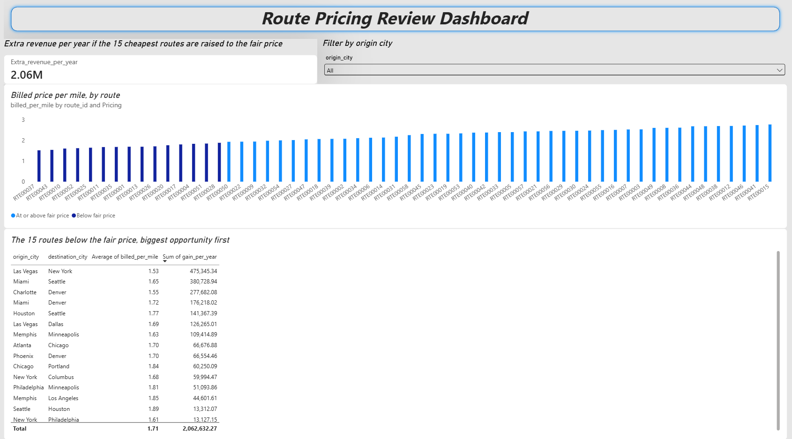

# Freight Route Pricing Review

I analysed 85,410 freight loads from a simulated trucking company to find out which routes are billed below the carrier's typical price per mile. **15 of the 58 routes sit below the 25th percentile price of \$1.90 per mile. Raising them to that level would add about \$2.06 million a year.**

Built with SQL, Python, Excel and Power BI.

**Table of Contents:** 
· [What I found](#what-i-found) 
· [How much is it worth?](#how-much-is-it-worth) 
· [If this were a real company](#if-this-were-a-real-company-what-id-recommend) 
· [How I did it](#how-i-did-it) 
· [About the data](#about-the-data) 
· [SQL](#sql-data-checks-and-route-pricing) 
· [Limits](#limits) · [Files](#files)

## What I found

- **The price gaps come from the rate card, not from discounting.** On every route, the price billed per mile matches the list price almost exactly (the largest gap is under 2 cents).
- **Distance doesn't explain the gap.** The cheapest route is Las Vegas to New York (2,561 miles at \$1.53 per mile). The most expensive is Philadelphia to New York (92 miles at \$2.78). Long and short routes appear at both ends.
- **Direction matters.** Philadelphia to New York is billed \$2.78 per mile, while New York to Philadelphia, the same 92-mile trip, is billed \$1.61.
- **A few routes hold most of the opportunity.** Las Vegas to New York alone is worth about \$475k a year, followed by Miami to Seattle (\$381k) and Charlotte to Denver (\$278k). The full list of 15 is in `flagged_routes.csv` and on the dashboard.

## How much is it worth?

The "fair price" is a judgement call, so I built an Excel what-if where one cell changes it:

| Scenario | Fair price per mile | Routes raised | Extra revenue per year |
|---|---|---|---|
| Conservative (25th percentile) | \$1.90 | 15 | \$2,062,632 |
| Middle (median) | \$2.23 | 29 | \$6,910,103 |
| Ambitious (75th percentile) | \$2.48 | 43 | \$12,385,109 |

I headline the conservative case. Raising 29 or 43 routes at once is a much bigger price move, and I can't defend the assumption that no customer would react to it.

## If this were a real company: what I'd recommend

The data is simulated, so this is hypothetical. But this is how I would act on the finding, in this order:

1. **Find out why each route is cheap before changing anything.** A low rate is only a mistake if nothing justifies it. I'd ask the pricing and sales teams whether each route is a deliberate rate (for example, to fill trucks that would otherwise return empty), tied to a contract, or an old rate nobody has reviewed. The data can't answer this.
2. **Check the cost per mile on the flagged routes.** The dataset also has trips, fuel and maintenance tables. A route that is cheap and cheap to run needs no fix. A route that is cheap and costs the same to run as the others is losing money, so that's where to act first.
3. **Start with the five biggest routes.** The top five (Las Vegas to New York, Miami to Seattle, Charlotte to Denver, Miami to Denver, Houston to Seattle) are worth about \$1.45 million a year together, roughly 70% of the total. The two smallest are worth only about \$13k each, which may not justify a customer conversation.
4. **Review routes priced differently by direction.** Philadelphia to New York and New York to Philadelphia are the same trip at \$2.78 and \$1.61 per mile. If the two directions cost the same to run, the gap needs a reason.
5. **Split each route's revenue by booking type.** The loads table has a `booking_type` column (Spot, Contract, Dedicated and others). Spot loads can be re-quoted straight away, while contract loads can only change at renewal. That shows how much of the \$2.06M is available this quarter and how much has to wait.
6. **Pilot before rolling out.** Raise the rate on 3 to 5 routes and watch for two or three months: load counts compared with routes left unchanged, and whether any large customer cuts back.
7. **Fix the cause so it doesn't come back.** Since the gaps come from the rate card itself, I'd add a minimum rate per mile tied to cost, a yearly review of every route's list price, and a standing report that flags routes far below the carrier's typical rate. The Python and Power BI work here already does that.

I'd describe the \$2.06 million as a ceiling, not a forecast. It assumes no customer reacts to a price rise, and the pilot is how a real company would find out how much smaller the real gain is.

## How I did it

1. **SQL:** checked the data, then joined loads to routes and worked out each route's billed price per mile (total revenue divided by loads times route distance).
2. **Python:** found the fair price, flagged the routes below it, and calculated the extra revenue for each one.
3. **Excel:** rebuilt the same calculation with one input cell. Its total matches Python's to the cent, which is how I checked both.
4. **Power BI:** built a one-page dashboard with the headline number, the price chart, the flagged routes and a filter by origin city.

The extra revenue for each flagged route is (fair price minus current price per mile) x miles driven / 3 years, because the data covers three years.

## About the data

- **Source:** [Logistics Operations Database](https://www.kaggle.com/datasets/yogape/logistics-operations-database) on Kaggle by yogape, licensed MIT. I used the original CSV files.
- **What I used:** the dataset has 14 tables. This project needs two: `loads` (one row per shipment) and `routes` (one row per route, with its distance and list price per mile). Period: January 2022 to December 2024.
- **Price used:** the base `revenue` column only. Fuel surcharges and extra charges are left out, so the figure is the price of the driving itself.
- **It's simulated.** The author describes it as a fictional trucking company, and the data looks like it: billed prices match list prices almost exactly, and every route has a similar number of loads (about 1,400 to 1,600). So the dollar figures show the method, not the results of a real business.
- **Quality:** I checked the two tables I used and found nothing to clean (details in the SQL section below). I didn't use or check the other 12 tables.

## SQL: data checks and route pricing

All the SQL is in `route_pricing_queries.sql`, in two parts.

**Part 1: data checks.** Before using the two tables, I checked whether they needed cleaning. Each check counts a kind of problem, so zero means the problem isn't there:

| Check | Why it matters | Result |
|---|---|---|
| Missing values in the columns used | A blank revenue would quietly distort a price per mile | 0 |
| Duplicate load or route IDs | The same load counted twice would double-count revenue | 0 |
| Loads pointing to a route that doesn't exist | They would silently drop out when the tables are joined | 0 |
| Zero or negative revenue, distance or list price | These can't be real values | 0 |

I also listed the load statuses. All 85,410 loads are Completed, so no loads were left out. The pricing query keeps a filter on Completed loads anyway.

Because every check came back clean, I changed nothing: no rows were deleted and no values were edited. The analysis uses the original data as it is.

**Part 2: the route pricing query.** It joins `loads` to `routes` on `route_id`, counts the loads on each route, adds up their revenue, and divides by loads times the route's typical distance. That gives each route's billed price per mile. The result is a 58-row table (one row per route), saved as `route_pricing.csv`, which Python, Excel and Power BI all use.

## Limits

- **"Cheap" doesn't prove "underpriced".** The data has no market price to compare against, so the finding is that these routes are billed well below the carrier's own typical rate.
- **No customer reaction.** The gain assumes load volumes stay the same after a price rise.
- **Estimated miles.** Miles driven use each route's typical distance, not the actual miles of each trip.
- **Even years assumed.** I divided the 3-year total by 3 without checking that each year had similar volume.

## Files

| File | What it is |
|---|---|
| `route_pricing_queries.sql` | Data checks and the route pricing query |
| `route_pricing.csv` | Output of the pricing query: one row per route |
| `route_pricing.ipynb` | Python analysis |
| `flagged_routes.csv` | The 15 routes below the fair price, with extra revenue |
| `price_per_mile_by_route.png` | Chart of price per mile by route |
| `route_pricing_whatif.xlsx` | Excel what-if with three scenarios |
| `route_pricing_dashboard.pbix` | Power BI dashboard (needs Power BI Desktop to open) |
| `dashboard.png` | Screenshot of the dashboard |
